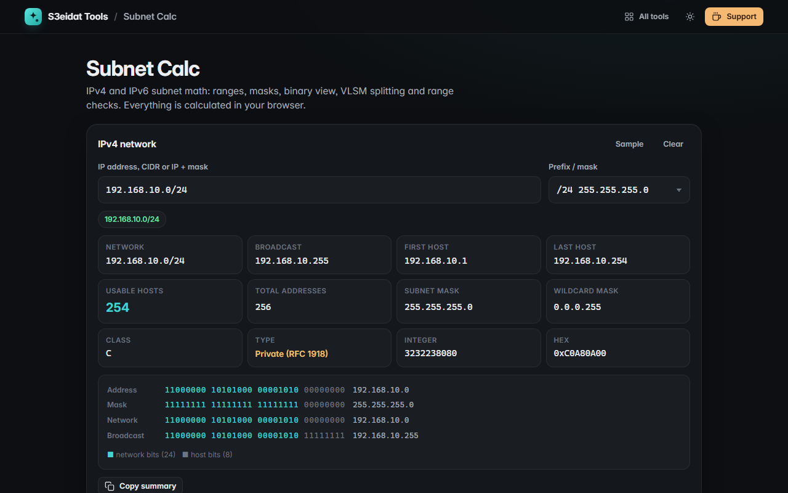

# Subnet Calc

> IPv4 and IPv6 subnet calculator with VLSM splitting and range checks. Free, private, and it runs entirely in your browser.

### ▶ [Open Subnet Calc](https://s3eidat.github.io/subnet-calc/)



## Features

- **IPv4**: type `192.168.1.0/26`, `10.0.0.5 255.255.255.0` or just an address and pick the prefix
- Network, broadcast, first and last host, usable and total addresses, subnet mask, wildcard mask, class, integer and hex
- **Binary view** with network bits and host bits coloured apart
- **Private / reserved detection**: RFC 1918, CGNAT, loopback, link-local, documentation, benchmarking, multicast, class E
- `/31` point-to-point links (RFC 3021) and `/32` single hosts handled correctly
- Wildcard masks such as `0.0.0.255` are recognised
- **Split** a network into N equal subnets, or **VLSM** by host counts (`Sales:50, HR:20`), largest first and properly aligned
- Copy the split table or download it as CSV
- **Range check**: is an IP inside a CIDR, a `start - end` range or equal to one address (IPv4 and IPv6)
- **IPv6** (BigInt math): expand, compress (RFC 5952), network, first and last address, address count, number of /64s, address type, `ip6.arpa` reverse name
- Click any result to copy it; the last input is remembered

## Privacy

Every calculation happens on your device. There is no server, no account, no analytics.
The page ships with a strict Content-Security-Policy (`connect-src 'self'`), so the browser
itself blocks any attempt to send data anywhere.

## Run it yourself

It's plain HTML, CSS and JavaScript with no build step:

```bash
git clone https://github.com/s3eidat/subnet-calc
cd subnet-calc
python -m http.server 8000
```

Then open http://localhost:8000.

## Support

If this saved you time, **[buy me a coffee ☕](https://s3eidat.github.io/coffee/)**. It keeps every tool free.

---

Part of **[S3eidat Tools](https://s3eidat.github.io/)**: 100+ free, private tools that run in your browser. MIT licensed.
